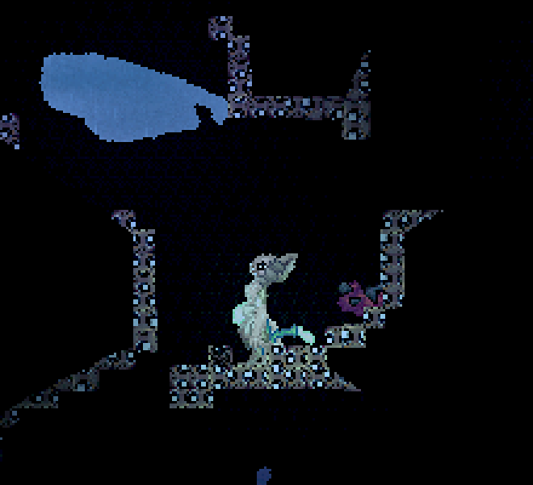

# EmojiTiles



A BepInEx plugin for Casualties: Unknown that draws every level block as one image. It only changes how blocks look on your own screen and sends nothing to other players.

## Install

Download the zip from the Releases page and unzip it into the game folder (the one with `CasualtiesUnknown.exe`). It needs BepInEx 5.4.23.5 (x64). To remove it, delete `BepInEx\plugins\EmojiTiles`.

To use a different picture, replace `BepInEx\plugins\EmojiTiles\tile.png` with any png and restart the game.

## Build

```
dotnet build -c Release
```

The project reads the game's assemblies from the default Steam folder. Use `-p:GameDir="path"` if the game is somewhere else. Copy `bin\EmojiTiles.dll` and a `tile.png` into `BepInEx\plugins\EmojiTiles`.
